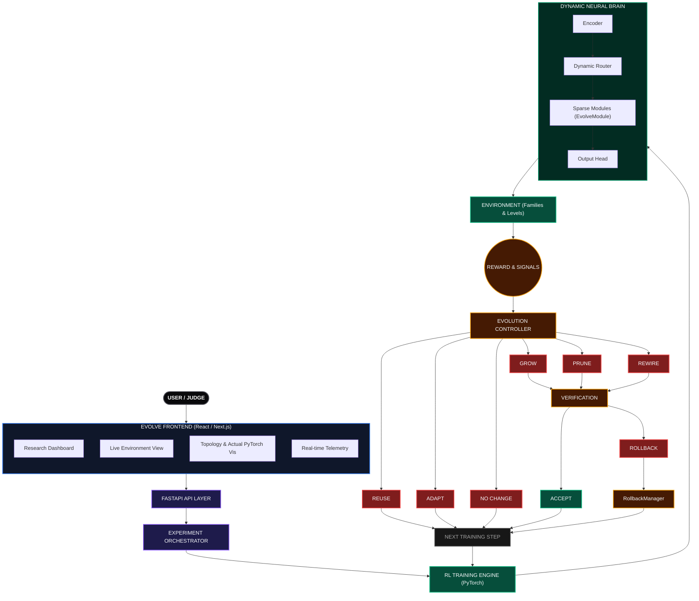

# EVOLVE: Visual System Architecture

This document presents the definitive engineering architecture of the EVOLVE self-adaptive neural framework, mapping directly to the actual PyTorch and Next.js implementations.

## System Flow & Decision Pipeline

---

## Architecture Implementation Mapping

The diagram above translates directly into the following codebase implementations:

### 1. EVOLVE Frontend
**Location:** `frontend/app/` and `frontend/components/`
- **Dashboard (`page.tsx`):** Coordinates the overall research view.
- **Visualizers (`BrainTopology.tsx` & `ActualArchitectureView.tsx`):** Receives base64-encoded PyTorch float arrays and binary masks to render exact neural representations via HTML5 Canvas and SVG.
- **Telemetry & State (`useEvolveState.ts`):** Maintains synchronized state via WebSockets.

### 2. FastAPI API & Orchestrator
**Location:** `backend/main.py`, `backend/websocket.py`, `backend/events.py`
- **FastAPI Layer:** Handles REST initialization (`/runs`).
- **Orchestrator:** Spins up the experiment background thread (`_run_experiment_thread`).
- **Event Bus:** Streams state updates (`TOPOLOGY_SNAPSHOT`, `METRICS_UPDATE`) via `ConnectionManager` to the frontend.

### 3. Training Engine
**Location:** `training/train_evolve.py`, `training/agent.py`
- **Engine Loop:** Orchestrates the standard PyTorch RL loop (`DQNAgent`).
- **Convergence (`training/convergence.py`):** Utilizes OLS slope variance to detect statistically principled plateaus, preventing infinite training cycles.

### 4. Dynamic Neural Brain
**Location:** `brain/brain.py`, `brain/module.py`, `brain/router.py`, `brain/topology.py`
- **Encoder -> Router:** Latent features are dynamically weighted across available active modules.
- **Sparse Modules (`EvolveModule`):** Utilize RigL-inspired binary masks (`mask1`, `mask2`) to enforce sparse connectivity.
- **Topology Snapshot:** Recursively inspects the PyTorch computational graph to serialize the exact architecture.

### 5. Environment System
**Location:** `environment/base.py`, `environment/families.py`, `environment/generators.py`
- Generates procedurally scaled tasks (`HierarchicalNavigation`, `MemoryObservation`, `AdaptiveDynamics`).
- Ensures BFS solvability upon generation via the `GridGenerator`.

### 6. Evolution Controller
**Location:** `evolution/controller.py`, `evolution/policies.py`, `evolution/signals.py`
- Receives reward plateaus and gradient statistics.
- Derives a singular `NeedScore` driving the structural decision policy.

### 7. Mutation & Decision Flow (GROW, PRUNE, REWIRE)
**Location:** `evolution/mutation.py`
- **GROW:** Adds a new `EvolveModule` to the registry, expanding router dimensionality.
- **PRUNE:** Drops severely underutilized modules.
- **REWIRE:** Executes RigL updates—dropping low-magnitude weights and activating dormant weights with high gradients.
- **REUSE / ADAPT:** Retains existing topology, delegating strictly to parameter gradient updates.

### 8. Verification & Rollback
**Location:** `evolution/verify.py`, `evolution/rollback.py`
- **Checkpointing:** Before speculative topology shifts, the `RollbackManager` strictly captures PyTorch `state_dict`, optimizer momentums, and RNG states.
- **Verification:** The `Verifier` tests new architectures against the current task and past task retention.
- **Rollback:** If structural cost outweighs performance gain, or if catastrophic forgetting occurs, the exact prior state is strictly restored. Verified by invariants in `tests/test_invariants.py`.
