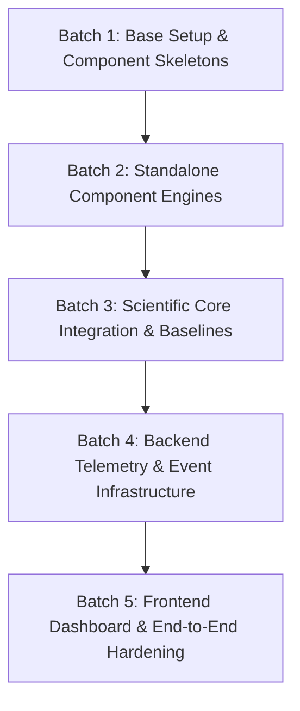

# EVOLVE Project — Internal Implementation Map & Technical Plan

## Executive Summary

This document serves as the authoritative **Internal Implementation Map** for the **EVOLVE** project (*Self-Adaptive Neural Architecture for Continual Generalization*). 
It synthesizes the specifications from two primary documents:
1. `docs/EVOLVE.docx` — Master Research Specification, Scientific Methodology & System Architecture.
2. `docs/EVOLVE_5_MEMBER_INDIVIDUAL_IMPLEMENTATION_HANDBOOK.docx` — 5-Member Implementation Responsibilities, Task Sequences & Definitions of Done.

> [!IMPORTANT]
> **Implementation Scope & Rule**: Source code implementation has **not** begun yet. This document provides the blueprint, repository structure, team handoffs, dependency mapping, and batch recommendations before execution.

---

## 1. Project Architecture & System Design

EVOLVE is a continual-learning neural system designed to evaluate whether a neural architecture can dynamically adapt its own computational structure ($REUSE$, $ADAPT$, $GROW$, $PRUNE$) based on measured evidence from its learning dynamics ($A \to B \to A$ experiment).

### High-Level Architecture Diagram
```
                     ┌──────────────────────────────────────────┐
                     │          NEXT.JS RESEARCH DASHBOARD      │
                     │ Environment | Brain Topology | Signals   │
                     │ Need Score | Decision | Charts | Timeline│
                     └────────────────────┬─────────────────────┘
                                          │ REST + WebSocket
                                          ▼
                     ┌──────────────────────────────────────────┐
                     │             FASTAPI BACKEND              │
                     │ Run API | Event Bus | WebSocket Server   │
                     │ Persistence Engine | Metric Collector    │
                     └────────────────────┬─────────────────────┘
                                          │
                                          ▼
 ┌──────────────────────────────────────────────────────────────────────────────┐
 │                           EVOLVE EXPERIMENT ENGINE                           │
 │                                                                              │
 │  ┌─────────────────┐       ┌─────────────────┐       ┌────────────────────┐ │
 │  │   Environment   │ ──►   │  Modular Brain  │ ──►   │ Agent / Optimizer  │ │
 │  │ (A / B / A Eval)│       │ (Encoder/Router/│       │  (Parameter Updates│ │
 │  └─────────────────┘       │ Modules/Head)   │       │   & Telemetry)     │ │
 │            ▲               └────────┬────────┘       └─────────┬──────────┘ │
 │            │                        │                          │            │
 │            │                        ▼                          │            │
 │            │               ┌─────────────────┐                 │            │
 │            │               │   Evolution     │ ◄───────────────┘            │
 │            │               │   Controller    │                              │
 │            │               │(Signals/Need/   │                              │
 │            │               │ Policy/Decision)│                              │
 │            │               └────────┬────────┘                              │
 │            │                        │                                       │
 │            │                        ▼                                       │
 │            │               ┌─────────────────┐                              │
 │            │               │    Mutation     │                              │
 │            │               │    Manager      │                              │
 │            │               │(Verify/Rollback)│                              │
 │            │               └────────┬────────┘                              │
 │            │                        │                                       │
 │            └────────────────────────┴───────────────────────────────────────┘
 └──────────────────────────────────────────────────────────────────────────────┘
                                          │
                                          ▼
                     ┌──────────────────────────────────────────┐
                     │        SQLITE & ARTIFACT STORAGE         │
                     │ Runs | Events | Metrics | Checkpoints    │
                     └──────────────────────────────────────────┘
```

---

## 2. Five-Member Responsibilities & File Ownership

| Member | Primary Ownership & Mission | File Ownership | Key Deliverables |
| :--- | :--- | :--- | :--- |
| **Member 1** | **Core Neural Brain & Integration Lead** | `brain/encoder.py`<br>`brain/module.py`<br>`brain/router.py`<br>`brain/head.py`<br>`brain/registry.py`<br>`brain/topology.py`<br>`brain/brain.py` | PyTorch Modular Brain, Differentiable Router, Module Registry, `add_module` runtime mutation, optimizer parameter-group updates, topology JSON snapshots, standalone brain demo (`demo_brain.py`). |
| **Member 2** | **Evolution Controller** | `evolution/signals.py`<br>`evolution/scorer.py`<br>`evolution/policies.py`<br>`evolution/controller.py`<br>`evolution/mutation.py`<br>`evolution/verify.py`<br>`evolution/rollback.py` | Signal calculator ($P, S, N, I, U, C$), Need Scorer ($Need = w_P \cdot P + w_S \cdot S + w_N \cdot N + w_I \cdot I - w_C \cdot C$), Decision policy (`REUSE`/`ADAPT`/`GROW`/`PRUNE`), budget & cooldown enforcement, `MutationManager`, `Verifier`, complete state rollback (`RollbackManager`). |
| **Member 3** | **Environment, Learning & Experiments** | `environment/base.py`<br>`environment/navigation.py`<br>`environment/generators.py`<br>`environment/scenarios.py`<br>`environment/evaluation.py`<br>`training/*.py`<br>`experiments/*` | Navigation simulator (Environment A & B), isolated $A$-after-$B$ retention evaluator, training loop (`agent.py`), metric schemas, Fixed NN baseline (`train_fixed.py`), Fixed+Replay baseline (`train_replay.py`), Always-Grow baseline (`train_always_grow.py`), EVOLVE runner (`train_evolve.py`), comparison plots & ablations. |
| **Member 4** | **Backend & Event Infrastructure** | `backend/main.py`<br>`backend/state.py`<br>`backend/events.py`<br>`backend/websocket.py`<br>`backend/schemas.py`<br>`backend/api/*`<br>`storage/*` | FastAPI app shell, `RunState` lifecycle machine, REST control endpoints, `EventBus` pub/sub, WebSocket real-time event streaming (`/runs/{id}/stream`), SQLite database models & repositories for runs/events/metrics. |
| **Member 5** | **Frontend & Research Visualization** | `frontend/app/*`<br>`frontend/components/*`<br>`frontend/types/*`<br>`frontend/hooks/*`<br>`frontend/lib/*`<br>`frontend/visualization/*` | Next.js App Router shell, TypeScript API contracts, `EnvironmentView.tsx`, `BrainTopology.tsx` (React Flow/SVG topology graph with router weight highlighting), `ControllerPanel.tsx` (signals & Need score breakdown), `DecisionCard.tsx`, `ResearchCharts.tsx`, `EventTimeline.tsx`, `TopologyDiff.tsx`. |

---

## 3. Recommended Repository Structure

```
evolve/
├── README.md
├── requirements.txt
├── requirements-dev.txt
├── .env.example
├── .gitignore
├── configs/
│   ├── base.yaml
│   ├── demo.yaml
│   ├── research.yaml
│   ├── environments/
│   │   ├── A.yaml
│   │   ├── B.yaml
│   │   └── C.yaml
│   └── experiments/
│       ├── fixed.yaml
│       ├── replay.yaml
│       ├── always_grow.yaml
│       └── evolve.yaml
├── brain/
│   ├── __init__.py
│   ├── encoder.py
│   ├── module.py
│   ├── router.py
│   ├── head.py
│   ├── registry.py
│   ├── topology.py
│   └── brain.py
├── evolution/
│   ├── __init__.py
│   ├── signals.py
│   ├── scorer.py
│   ├── controller.py
│   ├── policies.py
│   ├── mutation.py
│   ├── grow.py
│   ├── prune.py
│   ├── rewire.py
│   ├── verify.py
│   └── rollback.py
├── environment/
│   ├── __init__.py
│   ├── base.py
│   ├── navigation.py
│   ├── generators.py
│   ├── scenarios.py
│   └── evaluation.py
├── training/
│   ├── __init__.py
│   ├── agent.py
│   ├── train_fixed.py
│   ├── train_replay.py
│   ├── train_always_grow.py
│   ├── train_evolve.py
│   ├── optimizer.py
│   ├── checkpoints.py
│   └── metrics.py
├── experiments/
│   ├── runners/
│   ├── seeds/
│   ├── results/
│   ├── plots/
│   └── reports/
├── backend/
│   ├── main.py
│   ├── state.py
│   ├── websocket.py
│   ├── events.py
│   ├── schemas.py
│   └── api/
│       ├── runs.py
│       ├── metrics.py
│       ├── topology.py
│       └── evaluation.py
├── frontend/
│   ├── app/
│   ├── components/
│   ├── hooks/
│   ├── lib/
│   ├── types/
│   └── visualization/
├── storage/
│   ├── database.py
│   ├── models.py
│   └── repositories.py
├── tests/
│   ├── unit/
│   ├── integration/
│   └── fixtures/
└── scripts/
    ├── train.py
    ├── evaluate.py
    ├── compare.py
    ├── plot_results.py
    └── demo.py
```

---

## 4. Current Repository Status vs Implementation Work Needed

### What Already Exists
- `docs/EVOLVE.docx` (Master Project Specification)
- `docs/EVOLVE_5_MEMBER_INDIVIDUAL_IMPLEMENTATION_HANDBOOK.docx` (5-Member Implementation Handbook)
- *Note*: No source code files, configurations, or build scripts exist in the repository root yet.

### What Needs to Be Implemented
1. **Scientific Core Engine (Brain + Controller + Environment + Training)**
2. **Experiment Runners & Baselines (Fixed, Fixed+Replay, Always-Grow, EVOLVE)**
3. **Backend Server & Telemetry Engine (FastAPI + WebSockets + EventBus + SQLite)**
4. **Research Dashboard UI (Next.js + TypeScript + Tailwind + React Flow / Canvas)**
5. **Verification, Checkpointing & Rollback System**

---

## 5. Recommended Implementation Batches & Dependencies



### Batch Details

#### Batch 1: Base Setup & Component Skeletons (Parallel Member Work)
- **Goal**: Establish the repository infrastructure, dependency definitions, interfaces, and skeleton packages with unit test mocks.
- **Dependencies**: None.
- **Deliverables**:
  - `requirements.txt`, `.gitignore`, `configs/base.yaml`.
  - Member 1: `brain/` package skeleton + tensor shape contract tests.
  - Member 2: `evolution/` package skeleton + mock controller step.
  - Member 3: `environment/base.py` contract + `environment/navigation.py` (Environment A prototype) + `training/agent.py` skeleton.
  - Member 4: `backend/main.py` (FastAPI shell) + `state.py` lifecycle machine + REST schemas + `mock_run.py`.
  - Member 5: `frontend/` Next.js + TypeScript + Tailwind setup + static research console layout shell.

#### Batch 2: Standalone Component Engines (Independent Development)
- **Goal**: Build fully working standalone modules for each member with standalone proof scripts (`demo_brain.py`, `demo_controller.py`, `mock_run.py`, etc.).
- **Dependencies**: Batch 1.
- **Deliverables**:
  - Member 1: Complete `ModularBrain`, `ModuleRegistry`, `EvolveModule`, Differentiable `Router`, `TopologySnapshot`, runtime `add_module` operation, optimizer parameter group rebuilding.
  - Member 2: Complete `SignalCalculator` ($P, S, N, I, U, C$), `NeedScorer`, `DecisionPolicy` (budget & cooldown), `MutationManager`, `Verifier`, `RollbackManager` (model, topology, optimizer, controller state restoration).
  - Member 3: Environment B (regime shift), isolated $A$-after-$B$ evaluator, standard metrics schema (`metrics.py`), Fixed NN Baseline runner (`train_fixed.py`).
  - Member 4: Database models & SQLite storage repositories for runs, metrics, topology, events.
  - Member 5: `BrainTopology.tsx` (rendering dynamic nodes and routing weights), `ControllerPanel.tsx`, `EnvironmentView.tsx`.

#### Batch 3: Scientific Core Integration & Baselines
- **Goal**: Integrate Brain, Controller, Environment, and Training into the complete $A \to B \to A$ EVOLVE pipeline and build all baseline benchmarks.
- **Dependencies**: Batch 2.
- **Deliverables**:
  - Primary EVOLVE runner (`train_evolve.py`).
  - Baseline runners: `train_replay.py` (Fixed + Replay) and `train_always_grow.py` (Always-Grow).
  - Plotting and comparison scripts (`scripts/compare.py`, `scripts/plot_results.py`).
  - Ablation suite setup (no-novelty, no-stagnation, no-interference, no-cost, no-growth).

#### Batch 4: Backend Telemetry & Event Infrastructure
- **Goal**: Connect the scientific experiment runner to FastAPI, WebSockets, and SQLite persistence.
- **Dependencies**: Batch 3.
- **Deliverables**:
  - `EventBus` pub/sub integration emitting real experiment events (`TRAINING_STARTED`, `PERFORMANCE_DROP`, `DIAGNOSIS_UPDATED`, `DECISION_MADE`, `MODULE_CREATED`, `MUTATION_ACCEPTED`, `MUTATION_ROLLED_BACK`, `RETENTION_TEST_COMPLETED`).
  - WebSocket `/runs/{id}/stream` live event streaming.
  - Complete REST control endpoints (`POST /runs`, `/start`, `/pause`, `/reset`, `/evaluate`).

#### Batch 5: Frontend Visualization & End-to-End Hardening
- **Goal**: Connect the React dashboard to live backend WebSockets, perform end-to-end testing, and prepare demo workflows.
- **Dependencies**: Batch 4.
- **Deliverables**:
  - Live data binding for topology, controller signals, training/retention charts, and event timeline.
  - Demo hardening: pre-configured reproducible seeds and checkpoint path.
  - Project documentation (`README.md`, setup instructions, research report).

---

## 6. Critical Handoff Contracts & Invariants

To ensure independent development without breaking integration, the following interface contracts must remain strict:

1. **Tensor Shape Contract**:
   - Observation: `[batch, obs_dim]`
   - Latent representation: `[batch, latent_dim]`
   - Module I/O: `[batch, module_dim]` (all modules share identical input/output dimensions in version 1)
   - Action / Value output: `[batch, action_dim]`
2. **Telemetry Contract (Controller Input)**:
   - Controller receives measured signals: $P$ (Performance gap), $S$ (Stagnation), $N$ (Task novelty), $I$ (Interference), $U$ (Module utilization), $C$ (Structural cost).
   - **Forbidden**: Controller must **never** receive a direct `grow_now` flag or hard-coded task identity trigger.
3. **Rollback State Contract**:
   - On rejected mutation, `RollbackManager` must restore:
     - Model parameter weights
     - Module registry & topology graph
     - Router output dimensions and weights
     - Optimizer state & parameter groups
     - Controller continuation state
4. **Backend/Frontend Event Schema**:
   - Every mutation event MUST contain monotonic `step`, `phase`, `decision`, `need_score`, signal breakdown, and `mutation_id`.
   - Frontend **must never** animate a topology mutation unless a backend `MODULE_CREATED` / `MUTATION_ACCEPTED` event was emitted.

---

## 7. Ambiguities and Document Analysis

During document inspection, the following minor ambiguities and operational clarifications were noted:

1. **Filename Reference Mismatch**: The master spec text references `EVOLVE_MASTER_PROJECT_SPECIFICATION.docx` and `EVOLVE_5_MEMBER_IMPLEMENTATION_HANDBOOK.docx`, while the physical files in `docs/` are named `EVOLVE.docx` and `EVOLVE_5_MEMBER_INDIVIDUAL_IMPLEMENTATION_HANDBOOK.docx`. The physical files represent the true complete content.
2. **RL Algorithm Flexibility**: Master spec lists RL algorithm selection as an open benchmark parameter. Handbook Member 3 suggests DQN for discrete navigation. Recommendation: Benchmark DQN on Environment A first, freeze hyperparameters, and use the exact same algorithm across all baselines (Fixed, Fixed+Replay, Always-Grow, EVOLVE).
3. **PRUNE Priority**: Handbook Member 1 includes Task 11 ("Safe PRUNE"), but notes indicate PRUNE is a second-stage feature. Recommendation: Implement `GROW`, verification, and rollback first; enable `PRUNE` only after the core GROW lifecycle is proven.
4. **Baseline Resource Allocation**: Always-Grow allocates additional parameters automatically at task shifts. To ensure scientific fairness, structural cost metrics ($C$ and Parameter Growth) must be tracked and plotted for all methods.

---

## 8. Verification Plan

### Automated Tests
- **Unit Tests**:
  - `pytest tests/unit/test_brain.py`: Shape assertions, parameter registration, router softmax sums to 1.0, `add_module` expands router correctly.
  - `pytest tests/unit/test_controller.py`: Signal normalization, Need score calculation, budget/cooldown enforcement.
  - `pytest tests/unit/test_environment.py`: Reset/step contracts, seed reproducibility.
  - `pytest tests/unit/test_backend.py`: REST schema validation, state machine transitions.
- **Integration & Mutation Tests**:
  - `pytest tests/integration/test_mutation_rollback.py`: Verify that a rejected mutation restores exact model weights, topology, and optimizer parameter groups.
  - `pytest tests/integration/test_evolve_pipeline.py`: Run a short $A \to B \to A$ experiment end-to-end with fixed seeds.

### Manual Verification
- Execute `scripts/demo_brain.py` and `scripts/demo_controller.py` standalone scripts.
- Run `scripts/mock_run.py` to verify WebSocket streaming to the Next.js frontend console.
- Verify live WebSocket telemetry on `http://localhost:3000` during an active training run.
